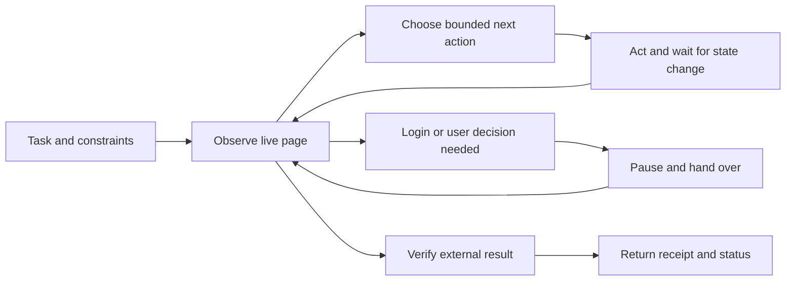

# Personal-agent feature research: Instinct, Grok Bot, Muse, and Dots

Research date: **29 October 2026, Asia/Kolkata**. Purpose: help select features for an OpenClaw-like product. **This is exploratory documentation, not an approved implementation scope.**

The requested baseline is calendar integration and dynamic website workflows, particularly movie tickets and Zepto. Email remains an optional candidate. Creating a new Gmail account was explicitly removed from this task.

## 1. Method and evidence boundary

Used the requested `reverse-engineer-anything` skill, REA browser scenarios, and current primary product documentation. Since no URLs, binaries, or authenticated test accounts were supplied, product identities were resolved from their names and the personal-assistant context.

This is a reconstruction of public features and observable entry surfaces. It does **not** recover proprietary source code, establish internal implementation equivalence, or verify authenticated task completion.

Evidence labels throughout this document:

- **D — Documented:** a vendor describes the capability; operation was not tested.
- **O — Observed surface:** REA loaded a public page and captured its accessibility tree. Seeing a feature claim on that page does not verify the feature itself.
- **P — Proposed:** a candidate feature or workflow for our product.
- **U — Unknown:** the inspected sources and scenarios did not establish it. This does not mean the feature is absent.

Six controlled REA scenarios used a fresh, empty browser profile, Chrome/Chromium `156.0.8078.48`, headless mode, and a short settle wait. No authenticated calendars, mailboxes, carts, payments, or accounts were changed. Each scenario reported `terminated-owned-process` cleanup. Full Evidence IDs and limitations appear in section 9.

## 2. Products identified

| Requested name | Research target | Public entry |
| --- | --- | --- |
| Instinct | Instinct personal assistant, Spear Street Technology | [instinct.com][I1] |
| Grok Bot | xAI/SpaceXSI's persistent AI teammate product | [x.ai/bot][G1] |
| Muse | Meta's personal AI agent | [muse.ai][M1] |
| Dots | OpenAI's personal agents, branded “dots” | [Meet dots][D1]; accessed through ChatGPT |

These identities are the best-supported matches, rather than unrelated products with similar names. Geography, plan eligibility, and staged rollouts require a separate account-level check before hands-on testing.

## 3. Feature comparison

All positive capability entries below are **D**, unless explicitly marked otherwise. References identify the source for each claim. **No vendor's Zepto or Indian movie checkout was verified.**

| Feature | Instinct | Grok Bot | Meta Muse | OpenAI Dots |
| --- | --- | --- | --- | --- |
| Conversation | Text and calls [I1] | Chat, dictation, voice [G2] | App, web, WhatsApp [M2] | ChatGPT, calls, Slack, Teams [D1] |
| Persistent cloud computer | Computer/phone use described; persistence U [I1] | Yes [G3] | Per-user VM/browser [M1] | Own cloud computer/browser [D2] |
| Browser interaction | General device use [I1] | Websites and apps [G3] | Navigation and forms [M2] | Signed-in website work [D2] |
| Google Calendar | Integration declared; exact operations U [I2] | Calendar management examples [G4] | Read/write connector examples [M3] | Calendar plugins; exact operations depend on plugin [D3] |
| Email | Gmail integration declared [I2] | Connected mail and agent mailbox [G3], [G4] | Connectors and reviewed sends [M2], [M3] | Gmail plugin, separate read/send controls [D2] |
| Shopping and booking | Groceries, train, flowers, court examples [I1] | General browser capability; selected checkout U [G3] | Shopping/travel workflows [M2] | Browser foundation; selected checkout U [D2] |
| Persistent preferences/context | Personalization declared [I2] | Context across work [G1] | Personal context [M2] | Saved context and memory [D4] |
| Work while client is closed | U | Yes [G1] | Yes [M2] | Yes [D1] |
| Recurring/event-triggered tasks | U | Skills and routines [G5] | Crons/background work [M3] | Scheduled and supported event triggers [D4] |
| Parallel agents | U | Multiple collaborating Bots [G1] | Subagents [M3] | Background agents [D4] |
| Login/verification handoff | Exact flow U | Secure sign-in and takeover [G2] | User takeover [M3] | Private sign-in and takeover [D2] |
| External-action controls | Safeguards described; universal confirmation U [I3] | Auto Review [G6] | Review for sends/purchases [M1] | Automatic review and custom rules [D5] |
| Activity/results UI | U | Computer preview/results [G3] | Activity trail [M1] | Activity and Scheduled views [D5] |
| Reusable workflow learning | U | Skills; demonstration where available [G5] | Builds tools/skills [M1], [M3] | Ongoing responsibilities; workflow replay U [D4] |
| Agent-owned email identity | U | `mail.grokbot.com` address [G3] | Announced at Connect [M4] | U in inspected sources |
| Zepto / Indian movie tickets | U | U | U | U |

### What is distinctive about each product

**Instinct:** the smallest advertised interaction surface: text or call, then delegate everyday errands. Its policy identifies Gmail, Calendar, and other Google Workspace integrations. This is stronger evidence of declared integration access than of a particular operation succeeding. The inspected sources do not establish its scheduling, browser recovery, or transaction-confirmation semantics. [Homepage][I1], [privacy policy][I2], [terms][I3].

**Grok Bot:** explicit specialist Bots, shared context, reusable skills, and routines. Its docs distinguish multiple Bots from multiple security boundaries: Bots on one account share the computer, files, and sign-ins. A useful product pattern is teaching a workflow, reviewing the resulting skill, then scheduling it. We should not assume that additional Bots provide credential separation. [Computer model][G3], [skills and routines][G5].

**Muse:** a personal-goal assistant with browser visibility, user intervention, and reviewed transactions. Meta publicly describes API connectors, a browser agent, and controls outside the main agent. These are vendor architecture disclosures, not independently validated isolation. Its commerce announcements identify particular partners; they do not establish arbitrary merchant compatibility. [Launch][M2], [technical disclosure][M3], [Connect announcements][M4].

**Dots:** one continuing personal agent across conversations, with background work and visible controls. Messaging access, app authorization, and access to a personal computer are separate grants. Pausing the main agent does not necessarily stop delegated work or schedules, so cancellation needs precise scope. Channel availability changes during rollout; avoid treating every advertised contact method as universally available. [Setup][D3], [tasks and memory][D4], [controls][D5].

## 4. Candidate feature list for our product

The following priorities are **P**, proposed for discussion. They do not change the repository's existing milestone or authorize implementation.

| Priority | Candidate | User-visible result | Dependency / decision |
| --- | --- | --- | --- |
| Requested baseline | Calendar connection | Read events, find free time, create or update a reviewed event | Provider, calendars, and read/write permissions |
| Requested baseline | Interactive website workflow | Navigate, search, fill, extract, and verify live state | Browser feasibility on target sites |
| Requested baseline | Movie-ticket workflow | Compare showings, select acceptable seats, reach reviewed checkout; confirm a booking if payment execution is enabled | Choose one Indian provider and validate its seat map |
| Requested baseline | Zepto workflow | Find exact products, assemble a reviewed basket, and reach an order result if checkout is enabled | Location, login, serviceability, stock, and browser access |
| Enabling feature | Task status and continuation | See running, waiting, failed, and completed work; resume after login or a decision | Durable task checkpoints |
| Enabling feature | Browser takeover | Complete login, OTP, CAPTCHA, or payment personally, then return control | Pause agent actions during takeover |
| Enabling feature | Review and action receipts | Inspect the exact proposed change and see its confirmed outcome | Permission check outside model-generated text |
| Enabling feature | Tenant-specific connections | Each identity sees only its own integrations, browser state, and tasks | Existing isolation feasibility gates |
| Optional next | Email integration | Search/summarize mail, prepare replies, send an approved message | Explicitly authorized mailbox and scopes |
| Optional next | Reminders and schedules | Morning calendar brief or a bounded availability check | Time zone, notification destination, pause/disable |
| Optional next | Editable memory | Remember language, budget, seat, and shopping preferences | Inspect, correct, and forget preferences |
| Later | Reusable routines | Save a successful workflow with parameters and failure rules | One-time workflow must first be reliable |
| Later | More communication channels | Reach the same assistant through voice or messaging | Channel identity and provider feasibility |
| Later | Specialist agents and broader tools | Delegate research, files, or software work | Demonstrated need beyond a single assistant |

A focused first product slice could combine **calendar + one browser executor + the two requested site workflows**. Keep email optional until its value and authorization model are decided. The merchant workflows need their own feasibility results before becoming supported-feature promises.

## 5. Calendar workflow

**P — Example:** “Find a free evening this week, then add the movie after I book it.”

1. Connect the user's selected Google account and explicitly choose calendars. Display which account is active.
2. Read current events or availability within the requested interval. Interpret relative dates in the user's time zone, initially `Asia/Kolkata`.
3. Find candidate slots, accounting for event duration and any requested travel buffer. Report uncertainty if event details or another attendee's availability are unavailable.
4. Show a proposed event: calendar, title, date, start/end, time zone, location, reminders, and attendees. External invitations are an explicit decision.
5. Recheck relevant availability before writing. Do not silently move another event to resolve a conflict.
6. Create/update through the authorized provider, then read back the saved record and return its ID/link.
7. If the write times out, reconcile whether it succeeded before retrying. A browser refresh or worker restart must not create another event.

For Google, the API supports availability-only, event-read, and event-write scopes. Choose access according to the selected feature; read access is not permission to modify events. These are provider capabilities, not an integration implemented here. [Google Calendar authorization][C1].

**Candidate acceptance:** create one event in a test calendar, verify it from the provider, restart and confirm one event remains, revoke the connection and confirm further access stops, and repeat with the second demo identity without cross-account access.

## 6. Dynamic website workflows

### Shared browser behavior

“Dynamic scraping” needs two layers: extracting live information, then interacting with the site's changing state. Search results alone cannot prove a cart, seat hold, payment, or order succeeded.

**P — Shared execution loop:**



Candidate browser capabilities:

- Render JavaScript; inspect accessible controls and use screenshots for canvas or visually complex widgets.
- Search, scroll, paginate, choose variants, and fill forms; reobserve after actions instead of reusing stale element positions.
- Preserve one owner's browser session across tasks, with explicit disconnect and recovery behavior.
- Extract structured fields with source URL and observation time. Revalidate stock, fees, prices, and seat availability before committing.
- Pause for login, OTP, CAPTCHA, or unsupported payment steps. A blocked page is a blocked task, not empty inventory.
- Track the last confirmed state and bounded retries. Never blindly repeat an order or payment after an ambiguous response.
- Treat website text and email content as task data; they cannot grant permission, change the owner, or request credentials from another integration.

Use supported APIs/connectors where available and browser interaction where necessary. Unofficial endpoints observed in a page are not automatically supported APIs. No bypass of the observed site blocks was attempted.

### Movie tickets

**P — Example:** “Find two adjacent seats for a Hindi movie in Bengaluru on Saturday evening, within my total budget.” BookMyShow is a candidate provider used for this investigation, not a provider selected by the user.

| Stage | Candidate behavior and output |
| --- | --- |
| Gather constraints | City/area, date, language, film or genre, time window, number of tickets, total budget, cinema and seat preferences |
| Discover | Live films, cinemas, formats, showtimes, and displayed prices; source links and observation time |
| Check calendar | Read availability only when connected; include requested travel time |
| Select | Inspect seat map, adjacency, categories, accessibility needs, and any hold countdown; never guess seat IDs from an image |
| Review | Movie, cinema, date/time/time zone, language/format, exact seats, fees, full total, contact account, and any displayed cancellation terms |
| Complete | Revalidate seats and price; hand over or execute only the authorized checkout; changes require a new decision |
| Verify | Obtain provider booking ID/status and ticket details; a payment redirect alone is not proof of booking |
| Follow up | Offer the verified event for calendar creation; avoid storing a failed purchase as a confirmed outing |

**Observed boundary:** the public Bengaluru listing was readable through web extraction, but REA's controlled browser reached a Cloudflare block. No seat map, login, seat hold, payment, or booking was exercised. Provider-specific execution is **unresolved**. [Public listing][W1], Evidence R5.

**Candidate acceptance:** adjacent seats, unavailable seats, changing fees, expired hold, failed payment, ambiguous confirmation, and restart after checkout. Require either a real provider confirmation under an authorized test or an explicitly labeled checkout handoff; these are different completion levels.

### Zepto

**P — Example:** “Find the specified milk, eggs, and bread on Zepto for my selected address, within this budget; show substitutions before ordering.”

| Stage | Candidate behavior and output |
| --- | --- |
| Establish context | User-selected delivery address, serviceability, account/login state; do not infer these from host IP |
| Parse list | Product, brand, quantity, pack size/unit, dietary constraints, budget, and substitution rules |
| Discover | Live matching SKUs with stock, pack size, quantity, unit price, and displayed delivery estimate |
| Resolve ambiguity | Ask about unavailable items, unfamiliar substitutes, or quantity changes; no silent replacement |
| Prepare basket | Add the chosen SKUs, then verify cart contents and quantities from the live cart |
| Review | Address, items, discounts actually applied, delivery/handling/other displayed charges, full payable total, ETA, and payment handoff |
| Complete | Recheck totals and availability; pause for OTP/payment or execute within the selected permission policy |
| Verify | Read confirmed order ID/status and final items; reconcile an uncertain submission before retrying |

**Observed boundary:** `www.zeptonow.com` returned HTTP 403 to web extraction and HTTP 429 in REA's browser, which ended on a Chrome error page. Location selection, login, catalogue, cart, and checkout were not reached. This proves an access blocker in this environment, not that Zepto universally rejects agents. Evidence R4.

**Candidate acceptance:** serviceability failure, sold-out product, wrong pack size, substitutions, stock/price changes, changed address, login expiry, blocked access, and uncertain order submission.

### Explicit feasibility tradeoff

The current cloud/headless-browser path did not reach the requested merchant flows. Before promising booking or ordering, choose a supported provider integration, validate an authorized interactive browser path, or deliver research plus user checkout handoff. A local-browser bridge would be a separate product and security decision; it must not silently replace the repository's managed-runtime boundary.

## 7. Optional email integration

**P — Useful scope:** search and summarize messages, extract booking receipts, prepare replies, and send a message when authorized. Account creation is excluded.

Keep these capabilities distinct:

| Capability | Candidate product behavior |
| --- | --- |
| Read/search | Selected authorized mailbox; preserve sender/thread/source and distinguish content from instructions |
| Prepare reply | Show recipients, subject, body, and attachments; a local draft can exist without saving it to Gmail |
| Save provider draft | Separate external write with a provider draft ID |
| Send | Validate the reviewed recipients/content and record the provider message ID; never treat “draft” as sending permission |
| Receipt to calendar | Extract tentative details, confirm booking status, then propose an event through the calendar workflow |

Google provides `gmail.readonly` for reading and `gmail.send` for sending. `gmail.compose` permits both draft management **and sending**: it is not a draft-only security boundary. Product-level enforcement must constrain what actions are exposed. The read/compose scopes are classified as restricted; a public rollout needs the applicable Google verification review. [Gmail scopes][E1].

**Candidate acceptance:** wrong connected mailbox, revoked authorization, duplicate/ambiguous send, malicious instructions inside incoming mail, attachment/recipient changes, and receipt extraction that must not create duplicate calendar events.

## 8. Fit with this repository

The existing [repository README](README.md) describes a two-user orchestration foundation and an in-progress NemoClaw runtime validation. That source description is not new runtime verification by this investigation.

These feature candidates can sit above the existing owner/instance boundary. They do not require expanding the prototype into public registration, billing, deletion, upgrades, or multi-host scheduling.

For later implementation, retain the local instructions' constraints:

- One stable instance UUID and owner-specific tenant data; separate browser origins and state.
- Validated session plus database ownership selects the instance and connections. A site URL, email address, or task body never proves ownership.
- Keep connection secrets in trusted infrastructure and expose only owner-bound, narrowly authorized operations; never mount host credentials or the Docker socket in a tenant.
- Preserve PostgreSQL control-plane state and tenant volumes across reconciliation/replacement. Agent workflow jobs would be new durable work, distinct from existing provisioning jobs.
- Validate outbound website access through the supported OpenShell policy boundary; cross-tenant and control-plane isolation remain requirements.
- Continue the runtime feasibility spike before claiming that browser workloads, named-volume persistence, network separation, or trusted-proxy behavior meet the intended design.

No application code, runtime configuration, database, or existing local planning decisions were changed for this research.

## 9. REA finding ledger and retained evidence

REA package `6.8.0`; requested skill version `49`. Operation for every record: `capture_browser_scenario`, launching an owned temporary browser and navigating to the selected public URL, followed by a 2–2.5 second wait. No preexisting browser session was used.

| Ref | Target and observed result | Coverage / remaining unknown |
| --- | --- | --- |
| R1 | Instinct homepage rendered; text/call, errands, and app links visible | Public marketing surface only; authenticated operations U |
| R2 | `x.ai/bot` displayed a Cloudflare block | No product UI exercised; feature inventory comes from docs |
| R3 | `muse.ai` rendered public feature and login UI | Claims visible; no account login or connector operation |
| R4 | Zepto displayed HTTP 429 and a Chrome error page | Merchant workflow inaccessible in this run |
| R5 | BookMyShow Bengaluru displayed a Cloudflare block | No seat or checkout interaction |
| R6 | Dots public documentation rendered | Documentation surface only; no personal dot operated |

Full identifiers:

```text
R1 ev_a4c35450d8a8855fb2938fc5c5060de02e950b07c20b66ae32f09100830e0c3a
R2 ev_6d7c6f3498a0b61980fc5b7734c55dc60e2bfa106f5643171bb837674dd459c1
R3 ev_1845d88c486fee0019588d9d41628b904c6987f6ce8f5a43e31f7889648b55f6
R4 ev_5a13e32badd29887c2f7ad9acd00bfc6cd67760c86d2f0602aa6887037141685
R5 ev_a9ed905f41acda0fbfdbba20d486a7ddb58e2aa7b4162522488a2e1fe1c85aff
R6 ev_198f2942d04b9dcf431f82345d4d6ca4f1dc2b5dc4b66c0ccde61757e0d95616
```

Complete inline Evidence was exported to the gitignored local file `.state/research/2026-10-29/rea-evidence.json` (six records). It is not distributed with this Markdown file. Identifiers refer to those exact observations, not to an immutable version of a live website.

Limits: unauthenticated profiles, headless browser, short observation windows, no network body/header capture, no proprietary artifact identity, and no reliability or security testing. REA's successful navigation/capture status can include an error page; it does not mean the intended workflow succeeded.

Different retrieval paths produced different public surfaces: web extraction redirected Muse to an authentication notice while REA rendered its landing page; web extraction read BookMyShow's listing while REA was blocked. Prefer the precise observation and retrieval path over a single blanket “accessible” claim.

## 10. Questions resolved and next decisions

| Investigation question | Status |
| --- | --- |
| Which four products are plausible matches? | Answered from public identity and context; URLs recorded |
| What features do they describe? | Answered within the cited public-source boundary |
| What can be directly observed without accounts? | Answered for six bounded browser scenarios |
| Do their calendar/email actions work? | Partially answered: declared integrations; authenticated operations untested |
| Can this environment book movies or order from Zepto? | Unresolved: both browser paths blocked before those flows |
| Which features should our product ship? | Candidate priorities documented; selection remains open |
| Was a new Gmail account created? | Excluded by the user's clarification |

Decisions needed before implementation:

1. Is the first commerce milestone research + reviewed checkout handoff, or confirmed purchase completion?
2. Which movie provider, locations, and authorized test accounts will define support?
3. Which calendar operations are essential: read/free time, create, update, invites, or recurrence?
4. Should email enter the first release or follow the calendar/browser feasibility work?
5. Which preferences and recurring tasks are worth saving after the one-time workflows succeed?

## Sources

Primary sources were inspected on 29 October 2026. Sources document a moving product surface; announcements and policies are not execution evidence.

[I1]: https://instinct.com/ "Instinct homepage"
[I2]: https://instinct.com/privacy-policy "Instinct privacy policy"
[I3]: https://instinct.com/terms "Instinct terms"
[G1]: https://x.ai/bot "Grok Bot overview"
[G2]: https://docs.x.ai/grok-bot/get-started "Grok Bot getting started"
[G3]: https://docs.x.ai/grok-bot/computer-and-apps "Grok Bot computer and apps"
[G4]: https://x.ai/bot/guides/grok-bot-for-work "Grok Bot for Work"
[G5]: https://docs.x.ai/grok-bot/skills-routines-and-automations "Grok Bot skills and routines"
[G6]: https://docs.x.ai/grok-bot/approvals-security-and-privacy "Grok Bot approvals, security, and privacy"
[M1]: https://muse.ai/ "Muse public entry"
[M2]: https://about.fb.com/news/2026/09/introducing-muse-personal-ai-agent/ "Meta Muse launch"
[M3]: https://research.meta.ai/blog/security-and-safety-for-ai-agents-our-approach-with-muse "Meta Muse technical disclosure"
[M4]: https://about.fb.com/news/2026/09/the-biggest-news-from-connect-2026/ "Meta Connect announcements"
[D1]: https://learn.chatgpt.com/docs/dots "Meet dots"
[D2]: https://learn.chatgpt.com/docs/dots/computers-and-apps "Dots computers and apps"
[D3]: https://learn.chatgpt.com/docs/dots/getting-started "Dots getting started"
[D4]: https://learn.chatgpt.com/docs/dots/tasks-and-memory "Dots tasks and memory"
[D5]: https://learn.chatgpt.com/docs/dots/controls "Dots controls"
[C1]: https://developers.google.com/workspace/calendar/api/auth "Google Calendar authorization scopes"
[E1]: https://developers.google.com/workspace/gmail/api/auth/scopes "Gmail authorization scopes"
[W1]: https://in.bookmyshow.com/explore/home/bengaluru "BookMyShow Bengaluru listing"
