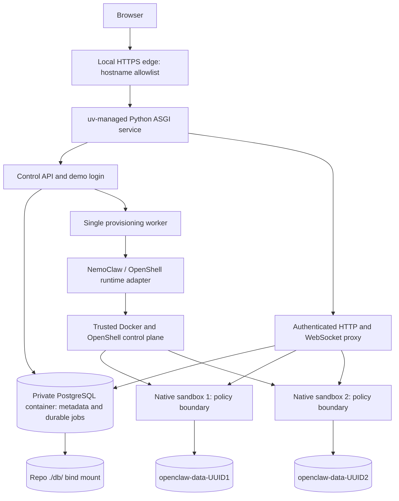

# Architecture and decisions

## Current implementation and frontend pivot

See 09-frontend-api.md for the separate-frontend contract. The API runs on the host through uv; native per-owner OpenShell gateways and private Unix-socket ingress replace the original proposed infrastructure-container/network attachment below. The pinned runtime uses its shared bridge plus native supervisor policies, not separately created tenant bridge networks. Exact observed behavior and unresolved isolation/recovery gates are in 08-runtime-findings.md. The topology below expresses the original logical boundary, not a verified separate-bridge deployment.

## Topology



Control and proxy are two logical APIs in one Python application for v0. The HTTPS edge handles TLS and approved Host values; it does not select a tenant upstream or skip application authorization. Only ingress is published. No user-supplied upstream URL is accepted.

The proposed integration deployment runs the trusted service in an infrastructure container with access to each tenant's private network and the runtime management interface. Python still runs through uv inside that image. Runtime tooling is installed and pinned during infrastructure build/setup, never during an HTTP request. Any Docker socket or management credentials belong exclusively to trusted infrastructure; their access is host-administrator authority. Tenant workloads receive neither. Exact management transport and network attachment are resolved by milestone 0.

## Component responsibilities

| Component | Responsibility |
| --- | --- |
| Auth service | Issue/validate JWTs, live-session checks, CSRF, switch/logout revocation |
| Instance service | Ownership, one-instance constraint, state transitions, safe public metadata |
| Provisioning worker | Consume persisted jobs, call runtime adapter, validate readiness, reconcile after restart |
| Runtime adapter | Pinned NemoClaw/OpenShell lifecycle, resource verification, private upstream discovery |
| Proxy | Authenticate, authorize owner, enforce hostname/origin, forward bounded HTTP and WS traffic |
| Tiny UI | Required buttons, status/error states, launch handoff |

Use FastAPI/ASGI, a maintained JWT library, an async HTTP streaming client, and a WebSocket client selected and pinned at implementation time. PostgreSQL stores orchestrator metadata; Python's UUID/secrets facilities generate identities. Use a PostgreSQL driver and bounded connection pool, selected and locked during API implementation. uv controls Python installation, dependency resolution, and process invocation; it is not the Docker scheduler or a production process supervisor. FastAPI supports WebSocket endpoints, but a transparent proxy still needs its own forwarding, backpressure, and lifecycle handling. [FastAPI reference](https://fastapi.tiangolo.com/advanced/websockets/), [uv project execution](https://docs.astral.sh/uv/guides/projects/).

## PostgreSQL deployment

The root `compose.yaml` provides service `db` using PostgreSQL 18. Its bind mount maps repo `./db/` to `/var/lib/postgresql`, with `PGDATA=/var/lib/postgresql/18/docker`. The host data is therefore `./db/18/docker/`; `/db/` is a repo-root ignore rule, not the host filesystem directory `/db`. This explicitly uses a bind mount so the database files live in the checkout as requested, while tenant OpenClaw data continues using separate Docker named volumes.

The DB joins only the infrastructure `control_plane` network. Host development uses loopback `127.0.0.1:${POSTGRES_PORT}`; the future Compose API uses `db:5432`. Tenant containers must never join this network or receive DB credentials. Keep passwords in ignored `.env`/secret storage; create a least-privilege application role before API integration. Add schema migrations and a DB readiness check before accepting state-changing requests. When PostgreSQL is unavailable, deny new proxy access and cancel ongoing authenticated streams rather than treating session/ownership checks as optional.

## Durable data model

| Table | Minimum fields and constraints |
| --- | --- |
| users | `id` immutable primary key; `display_name`; seeded user1/user2 |
| sessions | `sid` random primary key; `user_id` FK; issued/expires/revoked timestamps |
| instances | `id` UUID primary key; `owner_user_id` unique FK; state; logical sandbox name, actual native container name, volume and runtime ingress identity; runtime ID; image digest; compatibility tuple; readiness/error timestamps |
| provisioning_jobs | instance FK; unique active job; state; attempt count; lease and heartbeat; safe error code |
| launch_tickets | hash of random ticket; session/owner/instance bindings; target origin; expiry; consumed timestamp |

Use PostgreSQL foreign keys, unique constraints, and transactions. Keep the database cluster in `./db/`; keep signing keys, runtime registry/configuration, and provider bindings in separate private infrastructure state. None may be mounted into tenant workloads. Back up metadata too: the user's volume does not record ownership on its own. Labels are reconciliation evidence, not a substitute for the database.

## Provisioning sequence

1. Authenticate, verify CSRF, and resolve the user from the live session.
2. In a transaction, insert the instance UUID and a job; a unique owner constraint resolves concurrent duplicate requests. Return the existing row on contention.
3. Return `202` only after commit. The single worker claims the persisted job with a lease.
4. Reconcile each expected resource before creating anything. Verify exact ownership labels, runtime identity, volume driver/options, mounts, networks, and image digest.
5. Create the named volume, isolated network, and managed workload using only server-owned settings. Record each successful runtime identity.
6. Initialize durable directories with the verified image's UID/GID and configure the instance's own gateway and policy.
7. Probe runtime status, gateway readiness, mounts, and authenticated proxy/WS connectivity. “Container running” alone is insufficient.
8. Mark `ready` only after checks pass. On failure retain data and diagnostic metadata; close ingress and mark `failed`.

States: `pending -> provisioning -> ready`, with `pending/provisioning -> failed`; a previously ready workload can become `unavailable` after a failed live check. A failed instance is retained for bounded operator reconciliation using the same UUID. There is no user-facing recreate/retry API in v0. Restart scans pending, expired-lease, and ready records against the runtime before accepting proxy traffic.

Never hold a database write transaction while waiting on Docker or a CLI. Offload blocking calls, set deadlines, and cap jobs and resource requests. A crash between a runtime mutation and DB update is expected; exact labels plus stored UUID permit reconciliation. A conflicting/unmanaged resource causes a conflict, not adoption or deletion.

## Planned repository layout

```text
pyproject.toml                    # later implementation
uv.lock
src/claw_orchestrator/
  app.py
  auth.py
  db.py
  instances.py
  provisioning.py
  proxy_http.py
  proxy_ws.py
  runtime/
    base.py
    nemoclaw.py
  templates/
  static/
tests/unit/
tests/integration/
infra/                           # trusted image, HTTPS edge, runtime configuration
compose.yaml                     # orchestrator PostgreSQL service
.env.example                     # placeholders only
db/                              # ignored PostgreSQL cluster bind-mount source
.state/                          # ignored runtime registry and non-DB metadata
.secrets/                        # ignored keys and provider bindings
.certs/                          # ignored local certificates
AGENTS.md                        # ignored local instructions
agentdocs/                       # ignored local planning
```
